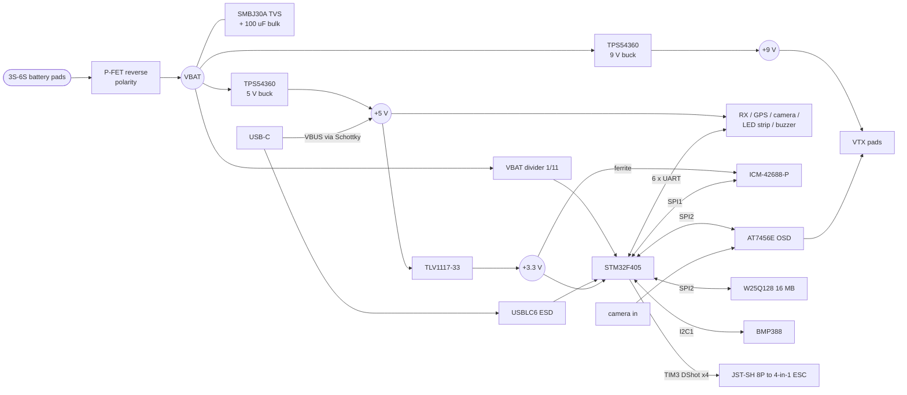
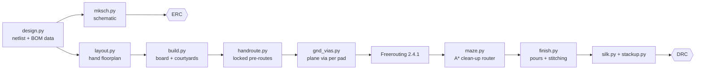

<div align="center">


# FC-F405

**A 30.5 × 30.5 mm STM32F405 flight controller for 5" FPV quads, 3S–6S.**<br>
Clean-power FC with two 60 V bucks, an ICM-42688-P gyro, analog OSD and a 16 MB blackbox.<br>
Six layers, 37 × 37 mm, designed in KiCad 10.


</div>

<table>
<tr>
<td align="center" width="50%"><br><sub><b>Top</b> · MCU, OSD, flash, baro, USB-C, every wire pad</sub></td>
<td align="center" width="50%"><br><sub><b>Bottom</b> · both bucks, battery input, gyro at dead centre</sub></td>
</tr>
<tr>
<td align="center"><br><sub>All six copper layers</sub></td>
<td align="center"><br><sub>Schematic (<a href="production/fc_f405_schematic.pdf">PDF</a>)</sub></td>
</tr>
</table>

## Specs

| | |
|---|---|
| MCU | STM32F405RGT7 · Cortex-M4F 168 MHz · 1 MB flash · LQFP-64 · 8 MHz crystal |
| Gyro | TDK ICM-42688-P on its own SPI1 bus, own ferrite-fed supply, INT1 → EXTI |
| Barometer | Bosch BMP388 on I2C1 (address 0x76), external-compass pads on the same bus |
| OSD | AT7456E (MAX7456-compatible) on SPI2, 27 MHz crystal, 75 Ω terminated video |
| Blackbox | Winbond W25Q128JV, 16 MB, SPI2 with its own chip select |
| Input | 3S–6S (26.1 V design max), P-FET reverse-polarity protection, SMBJ30A TVS, 100 µF / 50 V bulk |
| 5 V BEC | TPS54360 buck, 600 kHz, 3.5 A part / 1.5 A design load, TI reference-design values |
| 9 V BEC | TPS54360 buck, 22 µH, compensation recomputed for 9 V (≥ 85° phase margin) |
| 3.3 V | TLV1117-33 LDO off the 5 V rail, 800 mA part / 200 mA load |
| USB | USB-C with CC pull-downs, USBLC6-2SC6 ESD array, VBUS OR-ed onto 5 V through a Schottky |
| UARTs | 6: receiver, GPS, VTX, ESC telemetry, 2 spare |
| Motors | 4 × DShot on TIM3 CH1–4 (burst-mode DMA), JST-SH 8-pin ESC connector |
| Extras | WS2812 LED strip, buzzer driver, camera control, RSSI and current-sense inputs, 2 status LEDs |
| Mounting | 4 × M3 on 30.5 mm, 3.5 mm copper keep-out around each hole |
| Board | 37 × 37 mm, R5 corners, 6 layers, 1.6 mm, ENIG, matte black / white |

## Block diagram



## Stack-up

6 layers, 1.6 mm, outer 1 oz / inner 0.5 oz. Every signal layer sits next to a solid plane.

| Layer | Use | Dielectric below |
|---|---|---|
| L1 F.Cu | signals + digital parts | 0.20 mm prepreg |
| L2 In1.Cu | **solid GND plane** | 0.20 mm core |
| L3 In2.Cu | signals, +5 V / +9 V runs | 0.65 mm prepreg |
| L4 In3.Cu | signals | 0.20 mm core |
| L5 In4.Cu | **solid +3.3 V plane** | 0.20 mm prepreg |
| L6 B.Cu | signals + power parts | |

## Design notes

- **Clean FC.** No motor current crosses this board; VBAT is sensed, not distributed.
- **Gyro at the geometric centre**, on the bottom, with nothing switching near it. The two bucks sit at opposite edges of the bottom side, as far from the IMU as 37 mm allows, over an unbroken GND plane.
- **The 5 V buck is the 9 V buck rotated 180°**, not mirrored. A rotation keeps the TPS54360's pin chirality, so on both converters VIN faces its input ceramic, SW runs in one straight line through the catch diode into the inductor, and the boot cap sits across BOOT/SW. Both hot loops are as small as the parts allow.
- **60 V bucks on a 26 V rail.** The TPS54360's 65 V abs-max survives the hot-plug ringing that kills 28 V-class converters on 6S.
- **9 V compensation was computed, not copied.** TI SLVSBB4G Eq. 44–51 for the 22 µH / 2 × 47 µF output gives 11.5 kΩ / 33 nF / 47 pF, with ≥ 85° phase margin across 0–68 % output-cap derating. See [`docs/9v_compensation_result.txt`](docs/9v_compensation_result.txt).
- **OSD DVDD on 3.3 V**, AVDD/PVDD on 5 V, so the shared SPI2 bus never sees 5 V logic. Both SPI2 chip selects are pulled up, so the OSD and flash never wake on each other's traffic during reset.
- **Every decoupling cap is against its pin**, same side, with its own via into the plane.
- **IPC-7351 density-C courtyards** on every part, zero courtyard overlaps.

### Changes from the approved plan

| Change | Why |
|---|---|
| 4 → 6 layers, adds a solid +3.3 V plane | Two signal layers could not close the LQFP-64 fan-out on this board. Six layers keep GND solid under the top layer and give 3.3 V its own plane. |
| 36 → 37 mm outline | Keeps the plan's 5 mm corner radius clear of the M3 holes and buys routing room. |
| Barometer DPS310 → BMP388 | DPS310 is not stocked by the assembler. |
| STM32F405RGT6 → RGT7 | Stock. Same die and pinout. |
| 4 VDD decoupling caps, not 5 | LQFP-64 has four VDD pins (ST datasheet). |
| AT7456E RESET pull-up to +5 V | Datasheet: RESET abs-max is AVDD + 0.3 V and V<sub>IH</sub> is 2.1 V, so the OSD's own 5 V rail is legal. |
| Video pads 6 → 5, one shared GND | Frees the board edge the OSD supply pins need; both grounds also return through the plane. |
| USB VBUS → Schottky → +5 V | The plan never powered the board from USB. |
| Crystal load caps 10 pF → 15 pF | The sourced crystal has C<sub>L</sub> = 10 pF, not the 8 pF the plan assumed. |
| Signal rules 0.15 → 0.127 mm, 0.45 / 0.2 mm vias | Needed to fan out the LQFP-64 and HTSSOP-28. Still comfortably inside PCBWay's standard 6-layer capability. |

## Pinout

MCU pin map, from [`docs/DESIGN_PLAN.md`](docs/DESIGN_PLAN.md) §4.

| Function | Pins | | Function | Pins |
|---|---|---|---|---|
| SPI1 gyro SCK / MISO / MOSI | PA5 / PA6 / PA7 | | UART1 TX / RX (receiver) | PB6 / PB7 |
| Gyro CS / INT1 | PA4 / PC4 | | UART2 TX / RX (GPS) | PA2 / PA3 |
| SPI2 SCK / MISO / MOSI | PB13 / PB14 / PB15 | | UART3 TX / RX (VTX) | PB10 / PB11 |
| OSD CS / flash CS | PB12 / PC0 | | UART4 TX / RX (ESC telemetry) | PA0 / PA1 |
| I2C1 SCL / SDA | PB8 / PB9 | | UART5 TX / RX | PC12 / PD2 |
| Motor 1 / 2 / 3 / 4 (TIM3) | PB4 / PB5 / PB0 / PB1 | | UART6 TX / RX | PC6 / PC7 |
| LED strip (TIM1_CH1) | PA8 | | VBAT / current / RSSI ADC | PC1 / PC2 / PC3 |
| Beeper (FET gate) | PC13 | | Camera control (TIM8_CH3) | PC8 |
| Status LEDs | PB3 / PC5 | | USB D− / D+ | PA11 / PA12 |
| SWDIO / SWCLK | PA13 / PA14 | | BOOT0 / BOOT1 | BOOT0 pin / PB2 |

Wire pads, in pin order. Where the board is too dense for a label beside a pad, the label sits on the other side, behind the pad (J9 uses the short forms **VI** camera video in, **VO** video out). Groups with no room for every label carry a pin-1 dot.

| Pads | Pins |
|---|---|
| J1 battery (bottom, Ø3 mm) | VBAT, GND |
| J6 ESC, JST-SH 8P | CURR, VBAT, GND, M1, M2, M3, M4, TLM (UART4 RX) |
| J9 video | CAM_IN, +5V, GND, VTX_OUT, +9V |
| J10 / J11 / J12 / J13 / J14 | UART1 / 2 / 3 / 5 / 6 — +5V, TX, RX, GND |
| J15 | CAM_CTRL, RSSI, UART4 TX, +3V3, GND |
| J8 LED strip | +5V, DATA, GND |
| J7 buzzer | +5V, BZ− |
| J3 boot (top) | BOOT0, +3V3 — short to enter DFU |
| J2 SWD (bottom) | +3V3, SWDIO, SWCLK, GND |
| J4 I2C (bottom) | +3V3, SCL, SDA, GND |

## Verification

Final numbers from KiCad 10.0.5 on the shipped board (`hardware/drc.rpt`, `hardware/erc_final.rpt`).

| Check | Result |
|---|---|
| DRC: all severities, zones refilled, schematic parity on | **0 violations · 0 unconnected · 0 footprint errors** |
| ERC | **0 errors**, 3 reviewed warnings: U5 /WP and /HOLD tied to +3V3, BMP388 SDO tied to GND (address 0x76) |
| Courtyard overlaps (IPC-7351 density C) | **0** (the only flag is J5's USB-C shell overhanging the board edge, by design) |
| Nets routed | **91 / 91**, 1,643 track segments, 295 vias |
| Min track / space | 0.127 / 0.127 mm (5 / 5 mil) |
| Min drill / via | 0.2 mm / 0.45 mm |
| Power copper | VBAT and switch nodes 0.6 mm + 1.6 mm same-net floods, 0.2 mm HV clearance |
| Board ↔ schematic | in parity: same net names, no-connect pins, fields and mounting holes |
| BOM / CPL | 57 line items with LCSC + MPN; 105 placements (bare wire pads excluded) |

## Ordering

Fab files are in [`production/`](production/): Gerber + drill zip, BOM with LCSC part numbers and MPNs, pick-and-place, assembly drawing and schematic PDF.

| Setting | Value |
|---|---|
| Layers | 6 |
| Size | 37 × 37 mm |
| Material | FR-4 TG150 |
| Thickness | 1.6 mm |
| Min track / space | 5 / 5 mil (0.127 mm) |
| Min hole | 0.2 mm |
| Surface finish | ENIG (flat pads for the LGA gyro and baro) |
| Solder mask / silkscreen | matte black / white |
| Copper | 1 oz outer, 0.5 oz inner |

## How it's built

The board is generated from Python and reproducible from [`hardware/gen/`](hardware/gen/).



```bash
cd hardware
gen/run_all.sh /tmp/fc_build
```

A full run takes about 15–30 minutes, then `gen/production.sh` writes the fab files and `gen/images.py` these pictures. Freerouting results vary from run to run; the committed board is the one verified above.

## Status

> **Designed and DRC/ERC-clean. Not yet fabricated, assembled or flown.**

Before it flies it still needs:

- bench bring-up: current-limited power-on, check 5 V / 9 V / 3.3 V, then USB DFU enumeration;
- a Betaflight target config (resource map in [`docs/DESIGN_PLAN.md`](docs/DESIGN_PLAN.md) §9), checked against the built board;
- gyro alignment set for the bottom-side mounting;
- a 9 V load test. Treat 9 V as a 4S–6S feature: it may drop out late in a 3S pack.

## License

The hardware design files are released under the [CERN Open Hardware Licence v2 – Permissive](LICENSE) (CERN-OHL-P-2.0).
Vendor datasheets are not redistributed; [`datasheets/README.md`](datasheets/README.md) lists the documents used.
