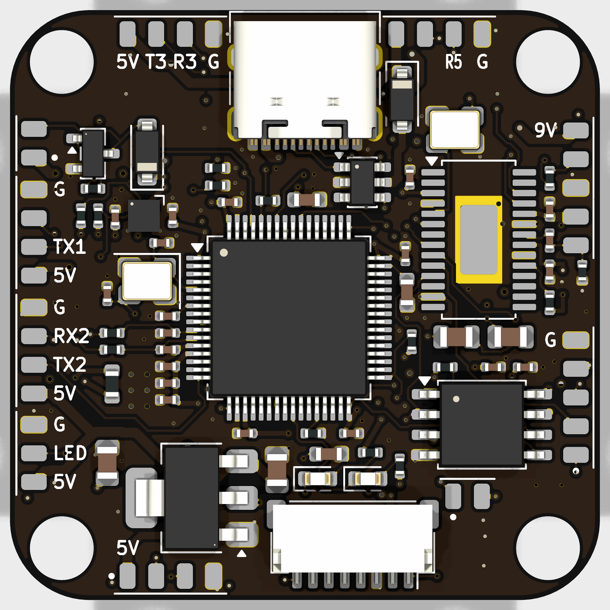
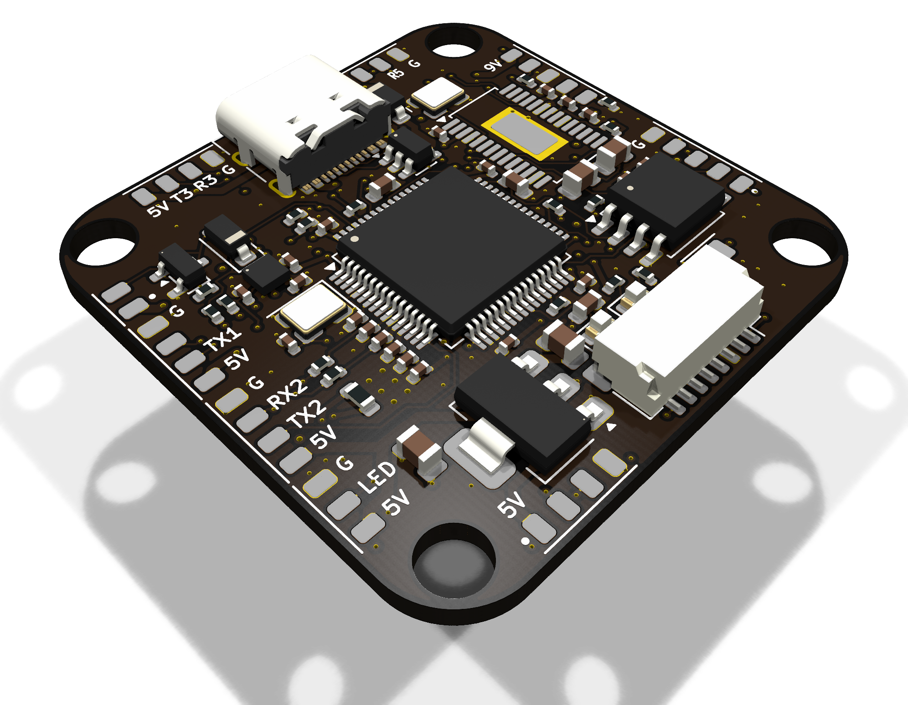
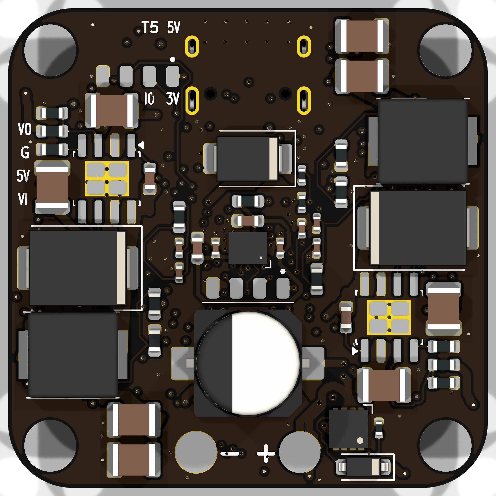
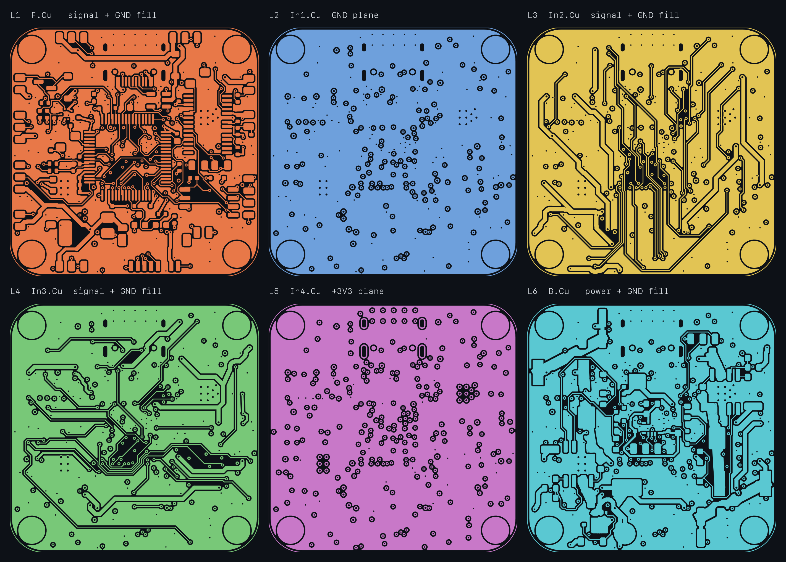
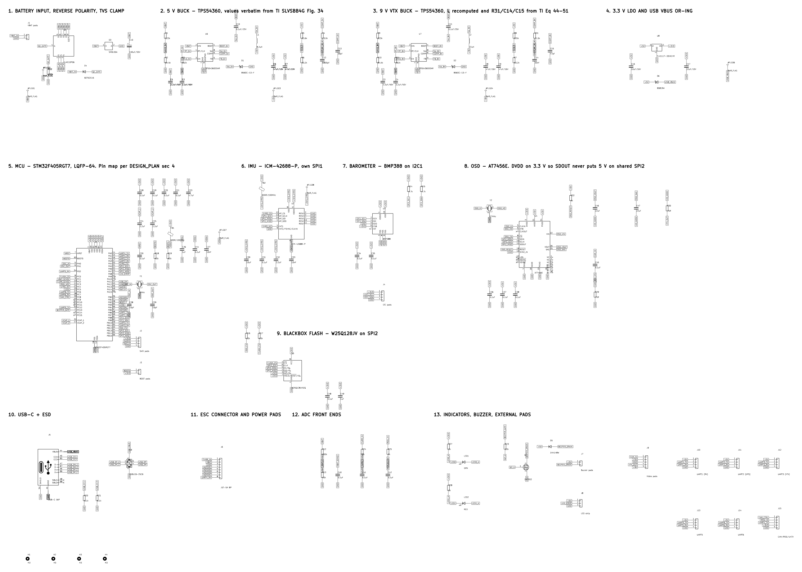

# F405 Flight Controller

I worked on this flight controller as a fun and challenging personal project. I plan to build a drone with it in the future.

## The design

I used KiCad and Python scripts to put together the schematic and board layout, check the connections, and export the files for manufacturing.

The main controller reads the motion sensors and sends signals to the motor controllers. The board also handles power for its electronics and has connections for a receiver, GPS, and camera.

It hasn't been manufactured, assembled, or flown yet, so there's still building and testing ahead.

<table>
<tr>
<td width="50%"> Angled view</td>
<td width="50%"> Bottom view</td>
</tr>
<tr>
<td> Copper layers</td>
<td> <a href="production/fc_f405_schematic.pdf">Schematic</a></td>
</tr>
</table>

The design files are in [hardware/](hardware/), and the manufacturing files are in [production/](production/).

Licensed under [CERN-OHL-P-2.0](LICENSE).
